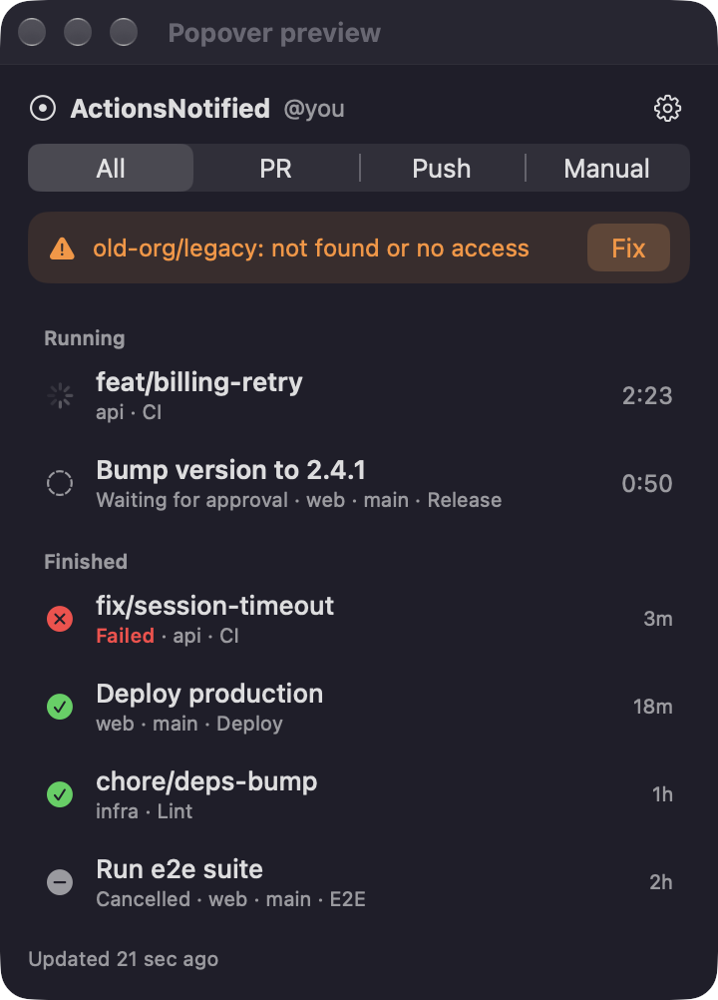

# ActionsNotified

A macOS menu bar app that tells you when the GitHub Actions runs **you started** finish.

It uses the [GitHub CLI](https://cli.github.com) you already have, so there's nothing new to sign in to and no token stored by the app.



## Requirements

- Apple Silicon Mac, macOS 26 or later
- `gh` installed and signed in: `brew install gh && gh auth login`

## Install

Download the latest `ActionsNotified-<version>.zip` from [Releases](https://github.com/amree/actionsnotified/releases), unzip it, and move `ActionsNotified.app` to `/Applications`. Releases are signed with a Developer ID and notarized by Apple.

On first launch a welcome window checks for `gh`, shows the repositories you pushed to most recently, and lets you pick the ones to watch. Allow notifications when macOS asks.

## Using it

- **Menu bar icon:** `○` nothing running, `◌` a run in progress, red `●` a run failed (clears when you open the menu).
- **Menu:** runs in progress with elapsed time, then recently finished runs. Filter by **All / PR / Push / Manual**. Click a run to open it on GitHub.
- **Rerun:** hover a finished run and pick **Rerun**, or right-click it. Failed runs can rerun only the failed jobs.
- **Notifications:** one per finished run, including reruns. Click it to open the run.
- **Settings** (gear menu or ⌘,):
  - *General:* launch at login, notify for every run / failures only / never, check interval, `gh` location, activity log.
  - *Repositories:* add with **+**, remove with **−** (or Delete). A repo that can't be reached is flagged with the reason.

Only runs where you are the triggering actor are shown. Dependabot, scheduled runs and other people's runs stay out.

## Build from source

Needs the Xcode Command Line Tools (`xcode-select --install`). There's no Xcode project; the Makefile calls `swiftc` directly.

```sh
git clone git@github.com:amree/actionsnotified.git && cd actionsnotified
make run        # build and launch
make install    # build and copy to /Applications
make clean
swift test      # unit tests
```

`open ActionsNotified.app --args -demo` launches with fake runs in every state and a preview window of the menu. Demo settings are kept separate from your real ones.

### Releasing

`make release` signs with your *Developer ID Application* certificate (hardened runtime), notarizes with an App Store Connect API key, staples the ticket and writes `ActionsNotified-<version>.zip`. Set `ASC_KEY_ID` and `ASC_ISSUER` in the environment or in an untracked `local.mk`; the key is read from `~/.appstoreconnect/private_keys/AuthKey_<ASC_KEY_ID>.p8`. `make publish` uploads the zip as a GitHub release.

## How it works

- Every 30 seconds by default, it calls `gh api repos/<repo>/actions/runs` for each watched repo and keeps runs whose `triggering_actor` is you. While nothing is running it backs off to every 2 minutes.
- A notification fires when a run goes from active to completed. Runs are keyed by `id#attempt`, so a rerun notifies again. The first poll after launch only records what's already finished.
- If a repo fails to load, its last known runs stay on screen instead of disappearing.

## Activity log

Every `gh` call is written to `~/Library/Logs/ActionsNotified/commands.log` (last 100 lines) with its duration and exit status, plus idle and skipped polls, so a gap between timestamps means a real stall. Open it from **Settings → General → Activity log**.

```
2026-11-12 09:51:09  gh api repos/owner/repo/actions/runs --method GET -F per_page=100  (3.90s, exit 0)
2026-11-12 09:51:13  idle — next poll in 120s
```

## Limitations

- Apple Silicon only.
- One `github.com` account (whichever `gh` is signed in to).
- Only the latest 100 runs per repo are checked, so on a very busy repo a long run can be missed.
